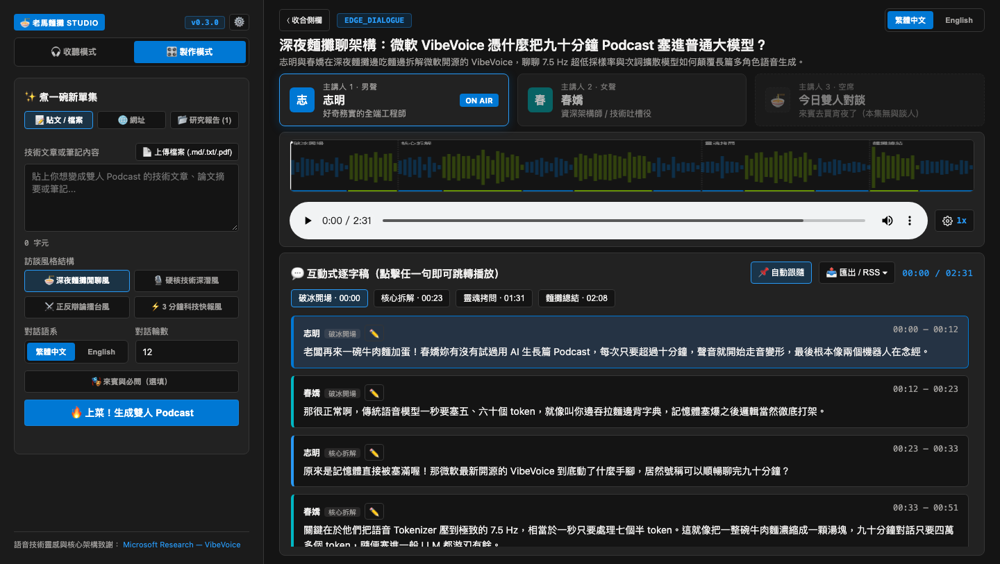
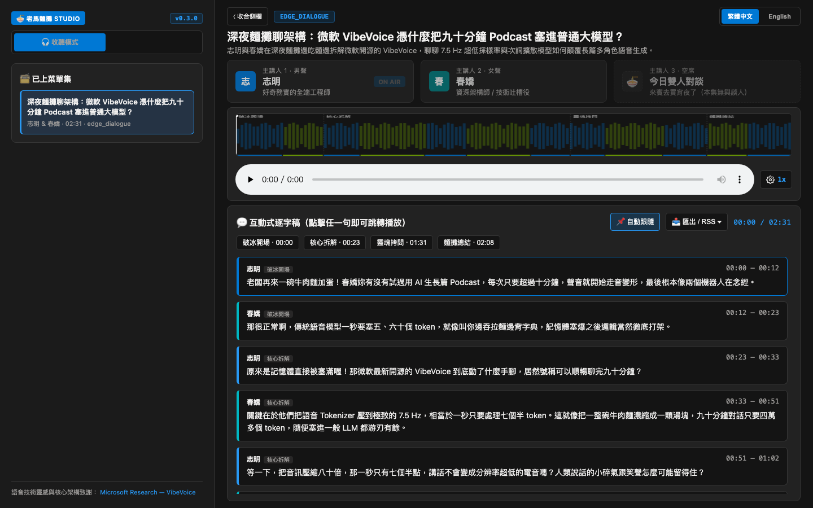

# 🍜 老馬麵攤 — VibePodcast Studio

[](https://github.com/tonnychiulab/vibe-podcast/actions/workflows/ci.yml)
[](LICENSE)
[](pyproject.toml)

> Version: `0.3.0` · License: MIT

這是一個在**挑戰 Google NotebookLM Audio Overview 的路上**，一邊摸索、一邊敲磚搭建的開源多角色技術 Podcast 小工作室。

我們還遠遠比不上巨頭的商業產品，但我們帶著**「春日部防衛隊（かすかべ防衛隊）」**的精神——*幾個夥伴湊在一起，邊吐槽、邊實驗、不怕出糗地火熱開幹*——把平常讀不完的技術文章、Hacker News 討論串、PDF 與研究筆記，端上深夜麵攤變成有節奏、有火花、還能自己修台詞重錄的雙人／三人技術 Podcast。

### English Overview

**VibePodcast (LaoMa Noodle Stand)** is a humble, self-hosted AI tech podcast studio built along the journey of learning from and challenging tools like NotebookLM. Turn Markdown notes, articles, URLs, or PDFs into multi-host conversations (`2–3 speakers`) with zero static API keys (`agy` CLI or local `Ollama`), **Edge-TTS dialogue**, cue-driven overlap mixing, **Show Bible** cross-episode continuity, single-turn re-recording, and **dual-role (`Admin` / read-only `Listener`)** RSS & web playback.

---

## 📸 Screenshots / 畫面預覽

### Studio 製作工作台（生成設定、單句微調與波形播放器）


### 受邀聽眾唯讀模式（Listener Mode — 僅收聽與匯出）


---

## Credits & Attribution

本專案的多角色長對話發想與介面細節靈感來自與致謝：
- **[Microsoft Research — VibeVoice](https://github.com/microsoft/VibeVoice)**

---

## ✨ Features（目前的進度）

- **兩階段省額度工作流與單句重錄**：先產出逐字稿結構，微調或修錯字後再合成音檔；每集保留獨立分段 `turns/`，支援**單句重新合成 (`resynthesize-turn`)**，不用整集重配。
- **零金鑰後端設計（本機 Ollama / CLI 訂閱授權）**：不存放雲端 API 金鑰，可透過本機 [Ollama](https://ollama.com/) 或已登入的 `agy` CLI 生成逐字稿。
- **節目聖經與跨集記憶 (`Show Bible`)**：可在偏好設定中維護節目口頭禪、主持人長期性格與禁用 AI 罐頭詞，並自動帶入最近集數摘錄作為自然呼應。
- **Cue 節奏混音與響度標準化**：依據每句情緒標記（`challenge`、`excited`、`thoughtful` 等）自動裁剪前後多餘靜音、做輕量搶話重疊混音，並以 `ffmpeg loudnorm`（`-16 LUFS`）輸出播客等級音訊。
- **長文 Map-Reduce 與多格式匯入**：支援貼文、網頁 URL 擷取（含 SSRF 檢查）、以及 `.md` / `.txt` / `.pdf`（`pypdf` / `pdftotext`）上傳。
- **雙角色權限與專屬 RSS 訂閱**：啟動時自動於本機持久化兩把隨機 Token：
  - **Admin Token**：完整生成、刪除、修改 Show Bible 與編輯權限。
  - **Listener Token**：僅能收聽、看逐字稿、下載 `.srt` / Show Notes 與透過 `/feed.xml` 在 Podcast App（Apple Podcasts / Overcast）訂閱，無法觸發你的 LLM 額度或瀏覽本機報告。
- **內建示範單集**：Repo 直接附帶一集 [demo-vibevoice-deep-dive](episodes/demo-vibevoice-deep-dive/) 供開啟介面立即試聽。

---

## Prerequisites / 事前準備

- Python `>=3.11` & [`uv`](https://docs.astral.sh/uv/)
- **`ffmpeg` 與 `ffprobe`**（必要，用於裁剪靜音、多軌混音與讀取音檔長度）：
  ```bash
  brew install ffmpeg          # macOS
  # sudo apt install ffmpeg    # Ubuntu / Debian
  ```
- **LLM 後端（零金鑰二選一，可於試聽模式下先不裝）**：
  - **本機模型**：[Ollama](https://ollama.com/)（完全免費離線，設定 `OLLAMA_BASE_URL=http://localhost:11434/v1` 或於介面選擇 `ollama`）
  - **本機 CLI 授權**：登入 `agy` CLI

---

## Quick Start / 快速啟動

```bash
# 1. 安裝依賴（含測試工具）
uv sync --extra dev

# 2. 執行零額度環境體檢 (Dry-Run Preflight)
uv run python -m vibe_podcast.preflight --dry-run

# 3. 啟動工作室（首次啟動會自動建立 Admin / Listener Token，預設於 ~/.config/vibe-podcast/）
uv run uvicorn vibe_podcast.server:app --host 127.0.0.1 --port 8765
```

啟動後在終端機 Log 中複製帶有 `?token=...` 的本機網址於瀏覽器開啟即可。若要分享給朋友「只聽不改」，複製帶有 **Listener Token** 的網址或點擊播放器中的 `📡 RSS Feed` 即可。

---

## 🧪 Running Tests / 執行測試

確認本機已安裝 `ffmpeg` 後，執行完整測試套件：

```bash
uv run pytest -v
```

---

## ⚙️ Environment Variables / 環境變數參考

可複製 [.env.example](.env.example) 為 `.env` 進行設定（請勿提交 `.env`）：

| 變數名稱 | 說明 | 預設值 |
| --- | --- | --- |
| `HOST` / `PORT` | 啟動腳本 `scripts/serve_studio.sh` 監聽位址與埠號 | `127.0.0.1` / `8765` |
| `VIBEPODCAST_EPISODES_DIR` | 單集音檔、`timeline.json` 與 `show_bible.json` 儲存目錄 | `./episodes` |
| `REPORTS_DIR` | 本機 Markdown 研究報告掃描目錄 | `./reports` |
| `OLLAMA_BASE_URL` | 本機 Ollama OpenAI 相容端點 | `http://localhost:11434/v1` |
| `OLLAMA_MODEL` | Ollama 預設模型名稱 | `qwen2.5:14b` |
| `VIBEVOICE_REMOTE_URL` | 選配的遠端 VibeVoice GPU 推論位址 | （未啟用） |
| `VIBEPODCAST_ALLOW_PRIVATE_REMOTE` | 是否允許連線私網／本機 `VIBEVOICE_REMOTE_URL` | `0` |
| `VIBEPODCAST_PUBLIC_URL` | 對外公開基底網址（例如 `https://podcast.example.com`），用於產出穩定 `/feed.xml` 與 CORS | （未設定） |
| `VIBEPODCAST_ALLOWED_ORIGINS` | 額外允許的 CORS Origin（逗號分隔） | （僅 localhost） |
| `VIBEPODCAST_TOKEN` | 固定 Admin Token（未設定則自動讀寫持久化檔案） | （自動隨機產生） |
| `VIBEPODCAST_LISTEN_TOKEN` | 固定唯讀 Listener Token | （自動隨機產生） |
| `VIBEPODCAST_TOKEN_FILE` | 自訂 Admin Token 持久化路徑 | `~/.config/vibe-podcast/session_token` |
| `VIBEPODCAST_LISTEN_TOKEN_FILE` | 自訂 Listener Token 持久化路徑 | `~/.config/vibe-podcast/listen_token` |
| `VIBEPODCAST_PRESETS_FILE` | 自訂匯入訪談範本儲存路徑 | `~/.config/vibe-podcast/custom_presets.json` |

---

## Cloudflare Tunnel 部署指南（自託管分享）

由於單集生成依賴本機 LLM、Edge-TTS 與 `ffmpeg`，本專案採用 **本機執行 + Cloudflare Tunnel 對外加密暴露**，不需開路由器防火牆埠，也不把 API 金鑰放上雲端。

1. **安裝 `cloudflared` 並登入授權網域**：
   ```bash
   brew install cloudflared     # macOS（Linux 請參考 Cloudflare 官方套件庫）
   cloudflared tunnel login
   ```

2. **建立 Tunnel 與 DNS CNAME 紀錄**：
   ```bash
   cloudflared tunnel create vibe-podcast
   cloudflared tunnel route dns vibe-podcast podcast.example.com
   ```

3. **設定 `~/.cloudflared/config.yml`**（範例可參考 [deploy/cloudflared.config.yml.example](deploy/cloudflared.config.yml.example)）：
   ```yaml
   tunnel: <TUNNEL_UUID>
   credentials-file: ~/.cloudflared/<TUNNEL_UUID>.json

   ingress:
     - hostname: podcast.example.com
       service: http://127.0.0.1:8765
     - service: http_status:404
   ```

4. **設定 `.env`**：
   ```env
   VIBEPODCAST_PUBLIC_URL=https://podcast.example.com
   # 若需固定跨機器/重啟不變的 Token 與 RSS 連結，建議填入隨機高熵字串：
   # VIBEPODCAST_TOKEN=...
   # VIBEPODCAST_LISTEN_TOKEN=...
   ```

5. **雙終端機啟動服務與 Tunnel**（[scripts/serve_studio.sh](scripts/serve_studio.sh) 會自動載入 `.env` 並啟用 `--proxy-headers --forwarded-allow-ips="127.0.0.1"` 以確保反代下 Cookie `Secure` 與真實協定辨識正確）：
   ```bash
   # 終端機 1：啟動帶有反代標頭支援的工作室伺服器
   ./scripts/serve_studio.sh

   # 終端機 2：啟動 Cloudflare Tunnel
   cloudflared tunnel run vibe-podcast
   ```

6. **邀請朋友收聽**：登入管理頁後點擊右上角 `📡 RSS Feed` 取得只讀 `LISTEN_TOKEN` 訂閱網址，或複製 `https://podcast.example.com/?token=<LISTEN_TOKEN>` 分享給受邀聽眾。

> 💡 建議同時在 Cloudflare Zero Trust 加上 **Access Email OTP**，多一層邊緣驗證更安心。

---

## 🤝 Contributing & Security

我們還在學習與改善的路上——歡迎開 Issue 討論、許願功能，或直接送 Pull Request 一起把這個麵攤變得更有趣！
- 提交 PR 前請先確認 `uv run pytest -v` 全數通過。
- 若發現任何安全性問題或漏洞，請參閱 [SECURITY.md](SECURITY.md) 以私下回報，避免在修復前公開細節。
